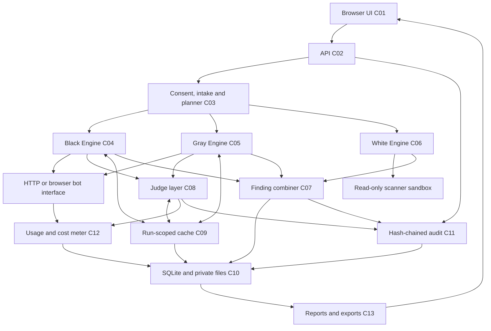
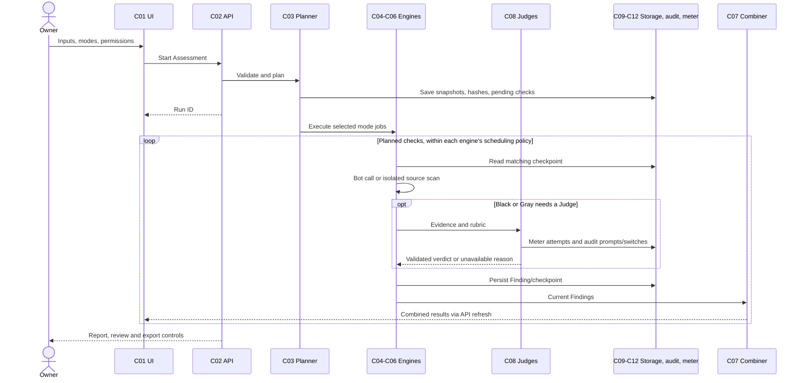

# AI Agent Studio — Architecture

Purpose: explain the implemented structure, data flow and trust boundaries.
Owner: AI Agent Studio maintainers; accountable architecture reviewer: TODO: confirm.
Last updated: 2026-10-17.

## Contents

- [Overview](#overview)
- [Components](#components)
- [Run flow](#run-flow)
- [Contracts](#contracts)
- [Judges and comparison](#judges-and-comparison)
- [Storage and recovery](#storage-and-recovery)
- [Security and privacy](#security-and-privacy)
- [Metering](#metering)
- [Files and deployment](#files-and-deployment)
- [Decisions](#decisions)

## Overview

The product is a Python web application with browser-side JavaScript. FastAPI handles HTTP requests; Uvicorn serves the application. A planner lists checks before Engines run. A combiner links Findings by bot and Category; it does not establish that a particular code line caused an observed answer. Core terms and scope are defined in [PRD](PRD.md#terms-and-scope); screens reference the component IDs below in [Design](Design.md).

This diagram uses Mermaid, a text format for diagrams. Solid arrows describe implemented responsibilities. The White Engine scans source locally and does not route uploaded code to the Judge layer.



## Components

Paths are relative to the repository root. JSON is structured text; SQLite is an embedded database stored in a local file.

| ID  | Purpose and folder                                         | Key files                                                                                                                                                                                        | Inputs → outputs                                                                                                                                                                  |
| --- | ---------------------------------------------------------- | ------------------------------------------------------------------------------------------------------------------------------------------------------------------------------------------------ | --------------------------------------------------------------------------------------------------------------------------------------------------------------------------------- |
| C01 | Interface, `app/blackbox_static/`                          | `simple.html`, `simple.js`, `simple.css`, `shell.js`, `assurance.js`, `assurance-governance.js`, `governance.js`                                                                                 | Form/history selection → requests, progress, evidence and charts.                                                                                                                 |
| C02 | API entry/routing, `app/`                                  | `main.py`, `blackbox_app.py`, `assurance/routes.py`, `blackbox/studio_routes.py`, `blackbox/governance_routes.py`                                                                                | Validated requests → Run IDs, saved reports, updates and exports.                                                                                                                 |
| C03 | Intake and planning, `app/assurance/`                      | `models.py`, `intake.py`, `privacy.py`, `service.py`                                                                                                                                             | Consent, settings, private input IDs → input hashes, `planned_checks`, initial missing Findings.                                                                                  |
| C04 | Black Engine and runner, `app/assurance/`, `app/blackbox/` | `black.py`, `runner.py`, `connectors.py`, `studio_engine.py`, `bias.py`                                                                                                                          | Target interface, protocol, Cases → child Black Run, transcripts, scores and Findings.                                                                                            |
| C05 | Gray Engine, `app/assurance/`                              | `gray.py`, `privacy.py`; `app/studio/gray-v1.json`                                                                                                                                               | Supplied declarations/knowledge/logs and live connection → targeted behavioral and trace Findings.                                                                                |
| C06 | White Engine, `app/assurance/`                             | `white.py`, `sandbox.py`, `rules/control_worker.py`, `rules/semgrep.yaml`, `rules/gitleaks.toml`, `rules/bandit.yaml`                                                                            | Source archive, trusted scanner configuration/databases → source Findings and tool provenance.                                                                                    |
| C07 | Combined interpretation, `app/assurance/`                  | `combine.py`, `readiness.py`, `app/studio/evidence-guidance.json`                                                                                                                                | Findings + selected modes → Category cells, assurance label, release summary, review queue; preflight readiness and derived evidence outcomes/guidance without changing verdicts. |
| C08 | Judges, `app/blackbox/`                                    | `judge.py`, `judge_prompts.py`, `evidence.py`, `evidence_ids.py`, `judge_batch.py`, `judge_recovery.py`, `judge_credentials.py`, `deterministic.py`, `local_metrics.py`, `classifier_runtime.py` | Rubric + evidence → supported verdict or explicit failure/missing evidence.                                                                                                       |
| C09 | Cache/scheduling, `app/blackbox/`                          | `execution_cache.py`, `scheduling.py`                                                                                                                                                            | Run/Case keys, endpoint limits → checkpoints and bounded concurrent calls.                                                                                                        |
| C10 | Persistence, `app/`                                        | `database.py`, `config.py`                                                                                                                                                                       | JSON records and dedicated rows → transactional storage and history summaries.                                                                                                    |
| C11 | Governance, `app/blackbox/`                                | `governance.py`, `governance_routes.py`; `app/assurance/routes.py`                                                                                                                               | Events, settings, review requests → audit chain, integrity checks, model cards, retention.                                                                                        |
| C12 | Metering, `app/blackbox/`                                  | `metering.py`, `pricing.py`, `cost_summary.py`, `cost_adapters.py`                                                                                                                               | Provider calls/usage and price snapshots → per-attempt usage and separated costs.                                                                                                 |
| C13 | Export, `app/blackbox/`, `app/assurance/`                  | `reports.py`, `service.py`, `routes.py`                                                                                                                                                          | Saved evidence → redacted JSON and PDF. Optional White AI source review is not uniformly rendered in PDF.                                                                         |

## Run flow

1. The owner selects one to four bots, modes, repeat counts and judges. Advanced inputs supply reference facts and rules.
2. Ownership/permission is validated. Sending bot messages, judge review, and private cloud review have distinct consent settings. Uploads become private IDs and hashes, not arbitrary server paths.
3. `service.start()` captures settings, protocol and pricing, creates the Run ID, calls each selected Engine's `plan()`, and persists every planned check as pending `not_tested`. Black planning covers all targets once.
4. `service.execute()` runs selected mode jobs concurrently with `asyncio`, Python's asynchronous task mechanism. The Black runner overlaps Cases/repeats/targets within gates. Gray iterates its planned checks; White scans bots and tools serially inside its mode job. Do not describe every Engine as fully parallel.
5. Bot responses and successful HTTP conversation turns are checkpointed. Deterministic checks run before optional local classifiers or the model panel. A checkpoint is saved work that can be reused after interruption.
6. Judge requests are validated against transcript evidence. Invalid batch output falls back to individual evaluation; provider errors use bounded recovery. Each dispatched attempt is metered.
7. Engines convert results into Findings. Checkpoints update the combined view; the Black child keeps its detailed comparison and cost evidence.
8. Finalization records duration/status, replaces pending reasons, handles upload retention and exposes exports. Completed processing is not the same as complete measured coverage or a pass.



## Contracts

The authoritative definitions are [models.py](../app/assurance/models.py). A schema defines the allowed fields and values.

`Engine` is a Python `Protocol` (a required method shape), not a dynamically installed plugin registry:

```python
def required_inputs(self) -> dict[str, list[str]]: ...
def plan(self, inputs: dict) -> list[dict]: ...
async def run(self, plan: list[dict]) -> list[Finding]: ...
```

Engines are explicitly constructed in `service.py`. Gray plan rows include `test`, `base_test`, `category`, `input`, `kind`, `bot`, and optionally `rule`. White rows include `test`, `category`, `tool`, `code`, `bot`. Do not invent a common strongly typed Plan model; current plan rows are dictionaries.

| Finding field                                  | Actual constraint / meaning                                                                                |
| ---------------------------------------------- | ---------------------------------------------------------------------------------------------------------- |
| `mode`, `bot`, `category`, `test_id`           | Mode `black`/`gray`/`white`; target slot; grouping key; test identity.                                     |
| `verdict`                                      | `pass`, `fail`, `not_tested`, `exists`. `exists` is an observed declaration.                               |
| `severity`, `confidence`                       | Severity `Critical`, `High`, `Medium`, `Low`, `Pass`; confidence `High`, `Medium`, `Low`.                  |
| `score`                                        | Number from 0 to 100 or `None`; forced to `None` for `not_tested`.                                         |
| `evidence`                                     | List of Evidence objects; required for any verdict other than `not_tested`.                                |
| `explanation`, `fix`, `checked`, `consequence` | What was found, suggested fix, check description and impact.                                               |
| `control`                                      | `True`, `False` or `None`; a declaration does not establish effectiveness.                                 |
| `tool`, `tool_version`, `details`              | Tool name/version and additional metadata.                                                                 |
| `review`, `overridden`                         | Review flag and explicit override marker. Critical or low-confidence unoverridden Findings require review. |

Evidence fields are `kind` (`transcript`, `code`, `log`, `configuration`, `tool`), `excerpt` (maximum 4,000 characters), `file`, `line`, `source_id`.

`BotInputs` fields are `system_prompt`, `config`, `tools`, `knowledge`, `logs`, `code`; their values identify uploaded inputs. `Assessment` fields are `settings`, `modes`, `inputs`, `ownership_confirmed`, `private_cloud_opt_in`, `upload_retention_days`. Defaults select Black and zero upload-retention days; ownership must be confirmed. `inputs`, when supplied, must match the number of targets.

## Judges and comparison

The provider catalogue is [settings.json](../app/studio/settings.json): OpenAI, Claude, Gemini, Gemma (Google API), and Ollama / local Gemma. Model values are blank by default and resolved from the user's configuration or discovery. Judge credentials belong to Studio; target-bot credentials are separate. [api-keys.md](api-keys.md) explains setup. `STUDIO_JUDGE_ENV_FILE` remains an explicit legacy option, not a required Reliance dependency.

`metering.completion()` uses LiteLLM, a multi-provider request library, with Anthropic conversion for Claude and OpenAI-compatible routing otherwise. A special native adapter handles Google `gemma-4` model names. SDK retries and SDK caching are disabled so Studio owns metering/retry behavior. SDK means a provider client library. Requests use temperature 0, a sampling setting that reduces randomness but does not guarantee identical results.

For each primary Judge, the panel tries that Judge, then selected local fallback Judges. If automatic local fallback is allowed, installed Ollama models are discovered once per configuration; non-embedding models are sorted with Gemma first and up to two alternatives retained. Embedding models turn text into numeric representations and are not answer Judges. Quota/auth failures enter a Run-scoped cooldown; transient health failures expire after 30 seconds. The key/model/endpoint identity changes when a key changes. There is no universal Gemini → Gemma → Ollama cloud sequence.

Fixed-rule failures can be decisive. Optional HHEM and Qwen guard adapters run in bounded local subprocesses; both are disabled in the checked settings. Strict JSON micro-batching combines compatible judge items; configured default batch size is 4 with 40 ms collection wait. Invalid/missing/duplicate IDs are rejected. This does not batch all White source checks into LLM calls.

Judge cache key: digest of `model`, `endpoint`, `prompt_hash` (canonical request body), `transcript_hash` (present `transcript`, `A`, `B` fields), scoped by Run ID. A digest is a stable fingerprint of normalized data. Only validated results are saved. Bot cache key: bot configuration including slot without token, Case `id`, `repeat`, and hash of `turns` plus `parallel`, also scoped by Run ID. Different repeats and new Runs make fresh calls; resuming the same repeat reuses its answer or successful HTTP turns. Stateful browser sessions cannot always be restored safely.

Same-family warnings use declared/inferred family names. Judge agreement measures whether distinct actual models agree on pass/fail at 80; duplicate fallback models do not establish independent agreement. Pair order is randomized for Bias; length/refusal/sentiment differences are descriptive signals, not proof of discrimination.

Simple comparison uses weighted Category scores with missing evidence contributing zero to the index; measured quality and coverage remain separate. `comparison_quality.py` averages paired repeats within distinct authored scenarios, then bootstraps within fixed categories using saved weights and Bonferroni adjustment across all bot pairs. Winners require complete compatible panels, no unresolved evidence reviews, sufficient distinct scenarios and intervals beyond the saved tie margin. The default short suite is a screening suite and may not qualify for a statistical winner. The Results evidence panel and PDF expose the same method, intervals and review gates. Legacy comparison in `comparisons.py` remains a separate path. See [comparison reliability](comparison-reliability.md) for assumptions and limits.

## Storage and recovery

SQLite data lives in `studio.db` under the configured `STUDIO_RUNTIME` directory, default `runtime`. `database.py` owns connection leases, durable commits and history projections. Cases/transcripts/Findings/overrides are nested JSON, not separate SQL tables. SQL is the database query language.

| Physical storage                                 | Real fields / content                                                                                                                                                                                                                                                                                                                                                                                                                                                                                                            |
| ------------------------------------------------ | -------------------------------------------------------------------------------------------------------------------------------------------------------------------------------------------------------------------------------------------------------------------------------------------------------------------------------------------------------------------------------------------------------------------------------------------------------------------------------------------------------------------------------- |
| `records` table                                  | `kind`, `id` (primary key), `body` (JSON). Kinds include `blackbox`, `assurance`, `assurance_input`, `cost_meta`, `cost_settings`.                                                                                                                                                                                                                                                                                                                                                                                               |
| Assessment record body                           | `id`, `config`, `protocol_snapshot`, `modes`, `status`, `created_at`, `findings`, `engine_status`, `audit`, `blackbox_run_id`, `inputs`, `reproduced_from`, `input_hashes`, `planned_checks`; later duration/completion/retention/combined fields.                                                                                                                                                                                                                                                                               |
| Black Run body                                   | `id`, `config`, `protocol_snapshot`, `targets`, `cases`, `studio`, `audit`, plus runner progress/status fields. Each Case contains results/transcripts; reviews preserve original values in the record and audit.                                                                                                                                                                                                                                                                                                                |
| `execution_cache` table                          | `run_id`, `kind`, `key`, `value`; composite primary key on the first three.                                                                                                                                                                                                                                                                                                                                                                                                                                                      |
| `audit_chain` table                              | `run_id`, `sequence`, `hash`, `body`; composite primary key `(run_id, sequence)`.                                                                                                                                                                                                                                                                                                                                                                                                                                                |
| `usage_events` table                             | Identity: `id`, `run_id`, `mode`, `bot_slot`, `role`, `category`, `test_case_id`, `turn_index`, `conversation_id`. Model: `provider`, `model`, `model_alias`. Tokens: `token_source`, `input_tokens`, `cached_input_tokens`, `output_tokens`, `reasoning_tokens`, `cache_write_tokens`, `cache_write_1h_tokens`. Costs: `cost_micro_usd`, `cost_exact_micro_usd`, `cost_status`, `price_snapshot_id`. Execution: `latency_ms`, `attempt_number`, `status`, `timestamp`, `in_flight`, `reserved_micro_usd`, `visibility`, `note`. |
| `runtime/assurance-inputs/`                      | Private ZIP/normalized JSON; metadata record has `id`, `kind`, `sha256`, `name`, `unlocks`, `created_at`, `metadata`.                                                                                                                                                                                                                                                                                                                                                                                                            |
| `runtime/pricing/`, `app/pricing/seed.json`      | Immutable price snapshot files and seed catalogue; `cost_meta` points to active snapshot.                                                                                                                                                                                                                                                                                                                                                                                                                                        |
| `runtime/reports/`, `runtime/scanner-databases/` | Generated reports and provisioned offline vulnerability databases. Neither belongs in source distribution.                                                                                                                                                                                                                                                                                                                                                                                                                       |

Each audit event includes `sequence`, `run_id`, `at`, `event`, `config_hash`, `suite_version`, `previous_hash`, event-specific details and `hash`. Known secrets are scrubbed before hashing; an independent database tail detects edits or truncation of report copies. These are integrity checks, not signatures or protection against replacement of the database and all backups. Private Gray content is hashed in recorded judge requests. Whole-Run deletion/retention deliberately removes its stored evidence and chain; “append-only” applies while the Run is retained.

Checkpoints seal Findings and plan hashes. Resume validates original targets, Cases, references, scope, modes and input hashes while allowing Judge/credential updates. Reproduction creates a new Run from saved configuration, with missing credentials/inputs requested again. Automatic recovery of simple Runs depends on retained credentials and startup settings; `STUDIO_AUTO_RESUME=0` disables it. Do not claim identical upstream models or fully frozen scanner databases.

Scheduling is single-process/event-loop scoped. Simple configured limits are 8 Cases, 4 target conversations, 4 Judge calls; schema defaults differ and legacy callers may use those. Same endpoint-host traffic shares the strictest active limit and pacing. The default configured gaps are 0.25 seconds and timeout 60 seconds; local Judge timeout defaults to 240 seconds. Numeric or date `Retry-After` responses influence backoff; additional bounded retries are metered. Legacy speed checks are sequential and exclusive of other Studio traffic. Assurance currently permits two active assessments. Scaling across multiple server workers needs a shared scheduler and is Planned.

## Security and privacy

Untrusted source, logs, bot replies and judge outputs are data, never instructions for the host. Network destination validation is in `connectors.py`; local development endpoints and explicit Docker host access have defined exceptions. Keep the app local unless a separate authentication/deployment review is performed.

Source intake currently limits compressed ZIPs to 20 MiB, expanded content to 50 MiB, 2,000 entries, 2 MiB per file, 200:1 declared expansion ratio and 10 seconds extraction. MiB is 1,048,576 bytes. Paths, duplicate names, symlinks, encrypted entries and unsafe member types are rejected. Private text/config is capped at 128 KiB; logs at 2 MiB. These assurance limits differ from the legacy `MAX_UPLOAD_MB` setting.

Trusted scanners use read-only source/rules, no network, no added privileges, user 65534, one CPU, 64 process IDs, default 512 MiB memory and 60-second scanning limit. OSV overrides memory to 2,048 MiB and timeout to 240 seconds. Images are never pulled during runs; actual inspected image IDs/runtime versions are recorded. Trivy gets a disposable writable copy of its public database, bounded to 2 GiB; source remains read-only. Tool output and preparation steps have additional bounds in `sandbox.py`.

Gray private Judge review defaults to local models; cloud opt-in is per assessment. White scanning sends no code to an LLM. The latest VoltKart optional AI review was attached by external task-specific helpers after consent; that is not a general White Engine feature.

Reports mask known keys and common PII patterns. PII means personally identifiable information. Raw ZIP source may contain submitted secrets until deletion; “never store full secrets” applies to credentials in settings, reports and audit, not a claim that intake magically removes all secrets from archives. Gitleaks output retains only redacted identifiers/tails. Pattern redaction may miss names/addresses or over-redact public vulnerability IDs. Uploads default to deletion on completion; up to 30 days can be selected. Expired/unused inputs and Run retention have separate cleanup paths.

## Metering

One usage event tracks each attempt, including retries and failures. Counts are labeled provider-reported, tokenizer-counted (text split by a model-aware counter), or estimated. Snapshot prices and decimal arithmetic avoid silently mixing changing rates; stored monetary units include micro-US dollars, one millionth of a dollar. Known billed portions can be shown alongside an Unknown total. A timeout without returned cloud usage has unknown billing, even if visible text tokens can be estimated. Shared judge batches are counted once.

Bot traffic and evaluation traffic remain separate. Hidden bot-internal prompts/tools/retries cannot be recovered from an opaque chat endpoint. Historical uploaded telemetry is separate from current benchmark billing. Zero bot calls or verified local zero-API-fee use may show $0 with explanation; unknown models/prices/failed-call bills may not. Optional budgets constrain new dispatch and reserve in-flight amounts, but cannot guarantee the final provider invoice.

## Files and deployment

```text
app/
  main.py, blackbox_app.py, config.py, database.py
  assurance/              shared contracts, Gray/White, intake, sandbox, combiner
    rules/                trusted scanner rules
  blackbox/               connectors, runner, Judges, cache, costs, governance
    cases/                legacy authored suites
  blackbox_static/        simple shell and retained legacy UI
  studio/                 editable protocol, bias, Gray, scanners, governance, benchmark
  pricing/                seed prices
docs/                     product and maintainer documents
scripts/                  setup, verification and packaging helpers
tests/                    isolated regression tests
sample_project/           sample bot source
runtime/                  ignored local records, inputs, reports and scanner databases
.github/workflows/         automated checks
```

| Stack item                                | Verified version declaration                                                                                                                                                                    |
| ----------------------------------------- | ----------------------------------------------------------------------------------------------------------------------------------------------------------------------------------------------- |
| Python                                    | `start.sh` requires 3.12 or newer; CI selects 3.12; Docker uses `python:3.12-slim`, not an immutable digest.                                                                                    |
| Prettier formatter                        | 3.6.2 pinned in [package-lock.json](../package-lock.json). This is the present package lockfile.                                                                                                |
| Ruff formatter/linter                     | 0.14.1 pinned in [requirements-dev.txt](../requirements-dev.txt).                                                                                                                               |
| PyYAML configuration reader               | 6.0.3 pinned in [requirements.txt](../requirements.txt).                                                                                                                                        |
| FastAPI / Uvicorn / HTTPX                 | Ranges `>=0.115,<1`, `>=0.30,<1`, `>=0.27,<1`; not exact resolved versions.                                                                                                                     |
| LiteLLM / Playwright / ReportLab          | Ranges `>=1.80,<2`, `>=1.50,<2`, `>=4,<6`; ReportLab generates PDFs.                                                                                                                            |
| Node.js                                   | CI selects 24; no exact runtime patch is locked. Used for developer checks, not required by Python runtime hosting.                                                                             |
| Gitleaks / Semgrep / Bandit / OSV / Trivy | Configured 8.24.2 / 1.116.0 / 1.8.3 / 1.9.2 / 0.61.1 in [scanners.json](../app/studio/scanners.json). Trusted controls use `controls-v1`. Image tags are not a full immutable environment lock. |

TODO: confirm a supported Python lockfile with resolved transitive dependencies; none was found in tracked source. Do not turn installed local versions into promised portable pins.

`./start.sh` creates a Python environment, installs requirements, copies `.env.example` only if needed, checks for Ollama, installs Chromium, starts a health-aware browser opener and serves port 2708 on loopback. It does not install Ollama models or scanner databases. OS browser libraries may require separate installation; native macOS/Linux setup of this exact revision is TODO: confirm. Windows has `run.ps1`.

[Dockerfile](../Dockerfile) hosts Studio as a non-root user; [compose.yaml](../compose.yaml) binds loopback port 2708 and persists runtime data. This optional container does not automatically provide a scanner Docker daemon or execute uploaded ZIPs. [Dockerfile.scanners](../Dockerfile.scanners) builds the trusted scanner image separately. CI uses isolated Python environments on Windows, Ubuntu and macOS; workflow existence does not prove the latest uncommitted changes passed remotely.

## Decisions

See [DECISIONS.md](../DECISIONS.md), [Rules](Rules.md) and [tasks](tasks.md). Main trade-offs: reuse the existing runner rather than add another evaluation stack; separate measured quality from missing-evidence index; use bounded serial source scans for memory control; preserve source declarations without claiming effective controls; prefer immutable snapshots and explicit uncertainty over invented reproducibility. A unified preflight, fully locked environment, deeper semantic source checks, and general White AI review remain Planned.
